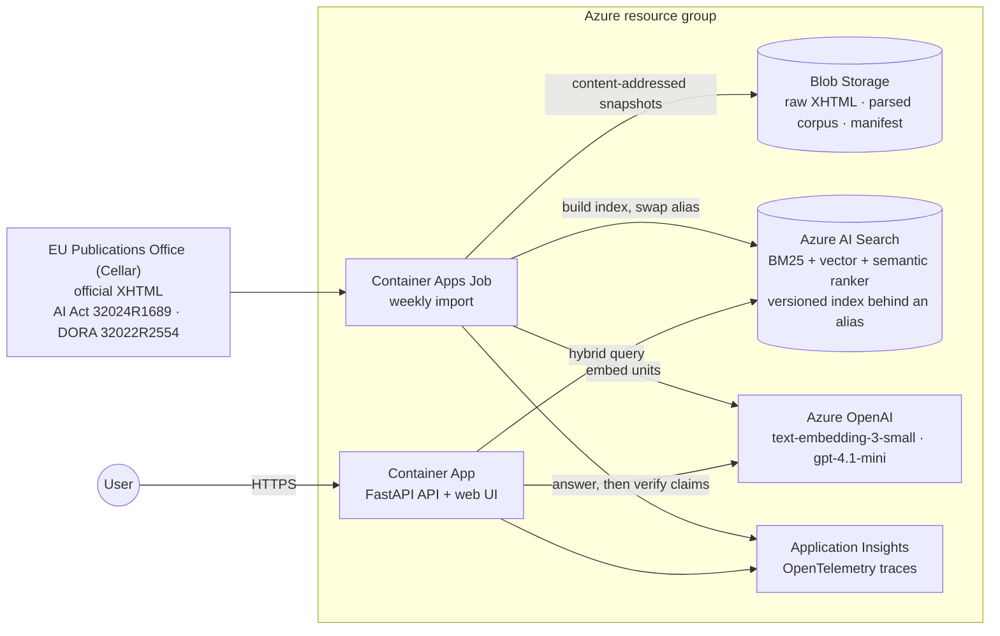

# Regulatory RAG Assistant

Imports the EU AI Act and DORA from official EU sources and generates cited answers with Azure OpenAI.
The application runs on Azure: Azure AI Search does the retrieval, Container Apps hosts the API, UI and weekly import job, and managed identities authenticate every call.

> **Status: research PoC.** In a 10-question pilot (9 November 2026, previous lexical pipeline with GPT-4.1 mini)
> the system cited the expected article for 8/8 answerable questions and abstained on 2/2 controls. Manual review
> found cases where a real quotation supported only part of a claim ([validation report](evidence/regulatory-rag-validation-2026-11-09.md)).
> This version is designed around that finding (point-level quotations and claim-support verification).
> **It has not yet been evaluated against a live Azure deployment.** Run `regrag eval` after deploying and record
> the result before quoting numbers for this version. The tool supports research. It does not give legal advice or assess compliance.

## Architecture



| Azure service | Role | Security defaults |
| --- | --- | --- |
| Azure OpenAI (AI Services) | `chat` (gpt-4.1-mini) for answers and claim verification; `embedding` (text-embedding-3-small) | `disableLocalAuth`, Entra ID only |
| Azure AI Search (Basic) | Hybrid BM25 + HNSW vector search, semantic reranking, one index per corpus snapshot behind the `regrag` alias | `disableLocalAuth`, RBAC only |
| Blob Storage | Raw official XHTML (SHA-256 named), parsed corpora, `active.json` manifest, eval reports | Shared keys and public access disabled, versioning, soft delete |
| Container Apps | Web app (scale to zero) and a scheduled job that imports every Monday | Optional IP allowlist, HTTPS only, non-root image |
| Container Registry | Image built remotely by `azd` | Admin user disabled, pull with `AcrPull` |
| Log Analytics + Application Insights | Traces with status, scores, claim labels, tokens, latency | App Insights local auth disabled |
| Managed identities | `id-web` (read-only) and `id-ingest` (write) | Least-privilege data-plane roles, see [rbac.bicep](infra/modules/rbac.bicep) |
| Cost Management budget (optional) | E-mail alerts at 80 % actual and 100 % forecast spend | |

## How an answer is built

1. **Import.** The job asks Cellar for each CELEX resource with `Accept: application/xhtml+xml` and `Accept-Language: eng`. Every redirect is upgraded to HTTPS and pinned to `publications.europa.eu`. EUR-Lex pages answer scripts with a WAF challenge, so they are only used as citation links. Any HTTP error, foreign redirect, unexpected content type or missing article stops the import.
2. **Citable units.** The parser reads the Official Journal layout, including the two-cell tables used for points. Each unit is one numbered paragraph, or a paragraph's lead-in plus one point with all its sub-points, for example *AI Act Article 5(1), point (c)* with conditions (i) and (ii). Chapter headings, annexes, signatures and recitals are excluded. Every article from 1 to N must be present.
3. **Index.** Units are embedded and uploaded to a new index named after the corpus digest, the embedding deployment and the schema version. The alias moves only after every document has been counted. An unchanged corpus re-uses its index, so the weekly import costs no embeddings. The previous index is kept for rollback, and older ones are deleted.
4. **Retrieve.** A hybrid keyword and vector query, filtered by act if requested, is re-ranked by the semantic ranker. The assistant abstains without calling the model when no result reaches the reranker threshold. The threshold is a provisional 1.2 out of 4 that needs calibration.
5. **Generate.** Azure OpenAI returns statements through a strict JSON schema. Each statement cites one excerpt ID from an enum of the excerpts actually supplied. **The model never writes quotations.** The application attaches the full text of the cited unit, so a quote cannot be invented, altered or cut before a condition.
6. **Verify.** Each claim is checked against its quotation. Rules first: figures and article references must appear in the cited text. Then a second model call labels the claim `supported`, `partial` (a dropped condition or qualifier, extra content, overgeneralisation) or `unsupported`. Under the default `strict` policy only `supported` claims are shown. Rejected claims are listed with the reason. If none remain, the answer is an abstention.

Truncated, filtered or refused model replies, malformed output and verifier inconsistencies are errors, never abstentions. The verifier is itself a model, so it reduces partial-support errors without eliminating them. Manual review remains part of the evaluation.

## Quick start (local, no Azure resources)

Python 3.11+:

```bash
python -m venv .venv && source .venv/bin/activate   # PowerShell: .venv\Scripts\Activate.ps1
pip install -e ".[local]"
regrag ask "What does DORA say about the ICT risk management framework?" --act DORA
regrag serve        # http://127.0.0.1:8000
```

The first command downloads both acts automatically (about 2 MB) into `.local/`. No manual download is needed. Without Azure configuration the local backend uses TF-IDF and returns evidence only (`retrieval_only`). To generate answers locally, set `AZURE_OPENAI_ENDPOINT` and `AZURE_OPENAI_CHAT_DEPLOYMENT` (see [.env.example](.env.example)) and run `az login`.

## Deploy to Azure

Requirements: [Azure Developer CLI](https://aka.ms/azd), Azure CLI, and Owner (or Contributor plus Role Based Access Control Administrator) rights on the subscription, because the template assigns roles. No local Docker is needed because the image is built in Azure Container Registry.

```bash
azd auth login && az login
azd env new regrag-dev
azd env set AZURE_LOCATION swedencentral
azd env set REGRAG_ALLOWED_IP_RANGES "203.0.113.10/32"   # optional: restrict the web app to your IP
azd env set AZURE_BUDGET_AMOUNT 50 && azd env set AZURE_BUDGET_EMAIL you@example.com   # optional
azd up
```

`azd up` provisions [infra/main.bicep](infra/main.bicep), builds and deploys the image, then runs the [postdeploy hook](scripts/postdeploy.sh), which points the ingest job at the new image and starts the first import (about 2–5 minutes). Until the import finishes, questions fail with a search error. Follow the import:

```bash
az containerapp job execution list -n "$(azd env get-value INGEST_JOB_NAME)" -g "$(azd env get-value AZURE_RESOURCE_GROUP)" -o table
```

Then open `azd env get-value WEB_URL`, or run the CLI against the deployment:

```bash
azd env get-values > .env.azure && set -a && . ./.env.azure && set +a
regrag ask "Under the AI Act, what transparency obligations apply to chatbots?"
regrag eval          # full ten-question pilot; writes JSON and a manual-review Markdown table to .local/eval/
```

Your user gets the same data-plane roles as the ingest job, so `regrag ingest --target azure` also works from a workstation.

**Parameters** (`azd env set NAME value`): `AZURE_OPENAI_CHAT_MODEL` / `_VERSION` (default `gpt-4.1-mini` / `2025-04-14`), `AZURE_OPENAI_CHAT_SKU` (`GlobalStandard`, or `DataZoneStandard` to keep processing in the EU data zone where offered), `AZURE_SEARCH_SKU` (`basic`; `free` disables the semantic ranker and allows one service per subscription), `REGRAG_ALLOWED_IP_RANGES`, `AZURE_BUDGET_AMOUNT`, `AZURE_BUDGET_EMAIL`. Model availability differs by region, and Sweden Central offers the defaults.

**Cost.** Azure AI Search Basic bills a fixed hourly rate and is the main fixed cost. Container Apps scale to zero. OpenAI is billed per token: the 9 November pilot used about 31k tokens for ten questions, before the added verification call. Embedding both acts costs a fraction of a cent and is skipped when the corpus has not changed. Check prices for your region in the [Azure pricing calculator](https://azure.microsoft.com/pricing/calculator/). **Remove everything with `azd down --purge`.**

### CI/CD

| Workflow | Trigger | What it does |
| --- | --- | --- |
| [CI](.github/workflows/ci.yml) | push to `main`, pull requests | ruff, pytest (offline fakes for Cellar, OpenAI and Search), `pip-audit` on the hash-pinned lock, Bicep build and lint, Docker build and smoke test (non-root user, `/healthz`, CSP header) |
| [Live ingest](.github/workflows/live-ingest.yml) | weekly, relevant pull requests | Real import from Cellar, [structure checks](scripts/check_corpus.py) on the real text (article coverage, point tables, AI Act Art. 5(1)(c) sub-points, no chapter headings in units), retrieval-only pilot |
| [Deploy](.github/workflows/deploy.yml) | manual | `azd provision` and `azd deploy` with OpenID Connect federation, so no Azure secret is stored in GitHub |

For the deploy workflow, create an app registration with a federated credential for `repo:JeanneBM/regulatory-rag-assistant:environment:azure`, grant it Owner on the subscription (or Contributor plus Role Based Access Control Administrator), and set the repository variables `AZURE_CLIENT_ID`, `AZURE_TENANT_ID`, `AZURE_SUBSCRIPTION_ID`, `AZURE_ENV_NAME` and `AZURE_LOCATION`.

## Security

- No secrets anywhere: OpenAI, Search, Storage and App Insights all have key auth disabled. The workloads use managed identities, and developers use `az login`.
- Separate identities: the web app can only read the index and the corpus, and only the ingest job can write.
- Questions and retrieved text are treated as untrusted. Prompts say so, outputs are schema-constrained, excerpt IDs are an enum, quotes are copied by the application, and the act filter is whitelisted before it enters an OData filter.
- The API validates input length, rate-limits per client (in memory, per replica), caps model-backed requests per day, returns generic 502s without provider details, and sends CSP, `nosniff`, `no-referrer` and `frame-ancestors 'none'` headers. The UI uses no third-party scripts. The OpenAPI UI is disabled.
- Telemetry records counts, scores, labels, tokens and latency. The question text is recorded only if `REGRAG_LOG_QUESTIONS=true`.
- Supply chain: hash-pinned runtime lock, `pip-audit` in CI, Actions pinned to commit SHAs, Dependabot for Actions, pip and the base image.
- The web endpoint is public unless `REGRAG_ALLOWED_IP_RANGES` is set. For other users, put Entra ID authentication (Container Apps authentication) in front of it.

## Configuration

All settings are environment variables, documented in [.env.example](.env.example) and [config.py](src/regrag/config.py). The most relevant: `REGRAG_BACKEND` (`local` | `azure`), `REGRAG_CLAIM_POLICY` (`strict` | `lenient`), `REGRAG_VERIFY_CLAIMS`, `REGRAG_MIN_RERANKER_SCORE`, `REGRAG_TOP_K`, `AZURE_OPENAI_VERIFIER_DEPLOYMENT` (to use a different model as the judge).

## Limitations

- The corpus is the original published acts, not consolidated versions. Amendments, corrigenda, delegated and implementing acts, annexes and recitals are not indexed. Retrieval timestamps are not dates of application.
- Retrieval thresholds are provisional, and the pilot set is small (8 answerable questions, 2 controls). Calibrate on 30–50 expert-reviewed questions, including adversarial ones, before relying on abstention behaviour.
- Claim verification is model-based and can be wrong in both directions. Keep the manual-review column in eval reports.
- Rate limits and daily caps are per replica.

## Repository layout

```
src/regrag/      cellar.py (download) · parser.py (citable units) · ingest.py · storage.py (local/Blob)
                 search_index.py (schema, versioned build, alias swap) · retrieval.py (Azure hybrid, local TF-IDF)
                 generation.py · verification.py · pipeline.py · api.py + static/ · evaluation.py · cli.py
infra/           main.bicep + modules (openai, search, storage, registry, identities, rbac, apps, monitoring, budget)
eval/pilot.json  the ten pilot questions with expected articles
scripts/         azd postdeploy hooks, real-corpus structure checks
tests/           offline tests with fakes for Cellar, Azure OpenAI and Azure AI Search
evidence/        validation reports
```
